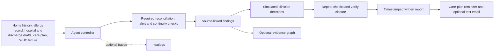

# Lognac

**A written-first, source-linked discharge medication review for a fictional UK patient.** Lognac follows a medicine from home history through hospital orders, draft discharge orders and patient instructions. It finds discrepancies, checks a specific WHO product/batch notice, asks a simulated clinician to document each decision, verifies the resulting drafts, then prepares a timestamped narrative and follow-up reminder. An optional evidence graph shows the same source trail.

This is a **synthetic hackathon prototype**. It is not for real patients, prescribing, emergency decisions or clinical deployment. The named reviewer field is a simulation, not authenticated clinical approval.

## Run locally

Requires Node.js 20.12 or newer.

```powershell
npm ci
npm test
npm start
```

Open [http://127.0.0.1:3000](http://127.0.0.1:3000). The server binds to localhost. `Reset demo` restores the fictional source record. For a terminal walkthrough:

```powershell
npm run demo
npm run demo -- --failure
```

The second command simulates one alert-source timeout, retries the required check and records recovery. With `NEATLOGS_API_KEY` configured, the terminal demo prints its exact trace ID and records the review, simulated decisions, final consistency gate and due-time reminder under one workflow trace. Verify that ID in Neatlogs; printing it does not prove hosted finalization. The browser's **Show failure recovery** button runs the same review path after reset. State is saved in `.local/case.json`, which is ignored by Git.

## Walkthrough

1. Run the agent review. It detects the amlodipine instruction mismatch, an amoxicillin allergy conflict, a reported HEALMOXY batch matching a WHO alert, and a chronic medicine supply gap before the documented follow-up.
2. Enter a **simulated** reviewer name and a decision reason for every finding. The replacement selector offers only a prior hospital order linked to the same recorded condition; it does not decide treatment.
3. Verify and finalize. Lognac runs the checks again and refuses to produce a final report while a discrepancy remains.
4. Read or download the timestamped report. Open **View evidence graph** for a side view of sources, medicine stages, findings and decisions.
5. Simulate the care-plan due time, then acknowledge the follow-up. If an allowlisted test mailbox and SMTP service are configured, a fictional reminder email is attempted at the due time. Report email delivery is a separate action and gets its own receipt.

## Optional configuration

Copy `.env.example` to `.env` and fill only the settings you use. `.env` is Git-ignored. The default runs locally without an API key or email service.

| Setting | Use |
| --- | --- |
| `NEATLOGS_API_KEY` | Trace the agent workflow, tool calls and optional model planner in neatlogs. |
| `NEATLOGS_ENDPOINT` | Set to `https://eu.ingest.neatlogs.com` only for a Neatlogs EU project. |
| `NEATLOGS_WRITE_KEY`, `NEATLOGS_PROJECT_NAME` | Optional independent JSON trace route. Use an `nlw_` write key and the exact Neatlogs project name. |
| `MODEL_API_KEY`, `MODEL_NAME`, `MODEL_BASE_URL` | OpenAI-compatible model to choose the next required review tool. The controller still enforces all required checks. |
| `ALLOWED_DEMO_EMAIL`, `SMTP_*` | Send only synthetic report/reminder email to one exact test address. |

The planner fallback is deterministic if no model is configured or a model call fails. The clinical checks are deterministic in both modes. **Do not place real patient data or credentials in the repository or in Neatlogs traces.**

If the SDK's OTLP trace is received but cannot be finalized in Neatlogs, a separate official JSON route is available for the fictional demo:

```powershell
npm run demo:http -- --dry-run --failure
npm run demo:http -- --failure
```

The first command builds a trace locally without sending it. The second posts the actual simulated run's event trail to Neatlogs with the write key. It prints a trace ID; **a successful HTTP receipt is not proof that Neatlogs finalized it**. Open that exact trace in the dashboard and verify its tool, simulated error, retry, decision and verification spans. This alternate route remains unverified until such a dashboard check succeeds. Do not disable project PII controls just to make a trace appear.

## Architecture



The case is stored as JSON for the demonstration. The controller can let a model choose the order of required tools, but the model cannot remove a required tool, clear a finding or select a medicine. A timeout of the safety check triggers one retry and an audit event. Decisions update drafts and preserve source IDs and timestamps. Finalization checks that instructions match orders and that all seeded safety findings are resolved.

## Safety scope and source provenance

- The [AHRQ MATCH toolkit](https://www.ahrq.gov/patient-safety/settings/hospital/match/chapter-5.html) motivates the comparison and discrepancy resolution workflow.
- The seeded product alert is [WHO Medical Product Alert N°2/2025](https://www.who.int/vanuatu/news/detail-global/23-04-2025-medical-product-alert-n-2-2025--falsified-healmoxy-%28amoxicillin%29-capsules-500mg). The demo matches **HEALMOXY 500 mg, batch 023011** as a specific reported pack. This is a curated fixture, **not a live or exhaustive WHO query**. WHO product alerts are not a universal list of drugs suspended for all patients.
- A patient's allergy record is checked separately from a product alert. A match means **review urgently**, not that the app has diagnosed a reaction or proved another medicine safe.
- A UK deployment would also need current [MHRA medicine and device alerts](https://www.gov.uk/drug-device-alerts), [NHS dm+d](https://digital.nhs.uk/services/terminology-and-classifications/dm-d) terminology, validated clinical rules, authenticated reviewers, record integration, governance and secure delivery. These are **not implemented** in this prototype. The MHRA source is available for manual review; the app does not claim that it has checked it live.
- [NHS guidance on hospital discharge](https://www.nhs.uk/nhs-services/hospitals/going-into-hospital/being-discharged-from-hospital/) informs the documented follow-up; [NHS guidance on secure email](https://digital.nhs.uk/services/nhsmail/guidance-for-sending-secure-email) illustrates why the demo's allowlisted SMTP is not a production clinical messaging system.

Exact text matching and one fictional case cannot establish clinical correctness. The alternative is merely a prior order for the same recorded condition; a qualified clinician must assess indication, dose, interactions, contraindications, pregnancy, renal function and the wider record. A real service must fail closed when source data or safety updates are missing.

## neatHack evidence

The [neatHack rules](https://neatlogs.com/hackathon) require neatlogs, Entire and cfo.ai. Neatlogs instrumentation is in `src/agent.js`; the `--failure` demo produces a recovery event. Entire project settings and Codex hooks are under `.entire/` and `.codex/`. The draft economics and evidence checklist are in `docs/`. **Connected neatlogs traces, an Entire checkpoint and an actual cfo.ai export must be added before submission**; local code and placeholder files alone do not prove partner use.

Project owner and Git commit identity: **Afghanistan8**.
