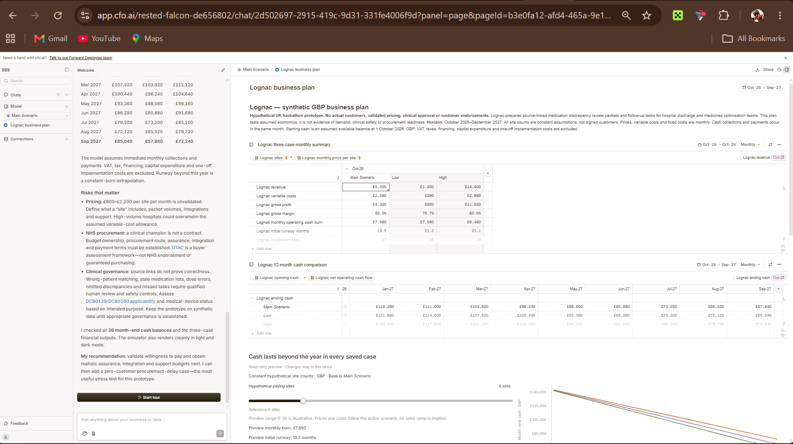

# cfo.ai business plan evidence

On October 11, 2026, the project owner created a **Lognac — synthetic GBP business plan** in cfo.ai. The [live shared plan](https://cfo.ai/s/DfJNW9w_YPYeVpGJ) and [captured screenshot](evidence/cfo-ai-lognac-plan.png) show the three-case monthly summary, a 12-month cash comparison, a site-count simulator and written pricing, NHS procurement and clinical governance risks. The shared plan opened without signing in during verification. This is actual cfo.ai output, rather than the input draft in [BUSINESS_MODEL_DRAFT.md](BUSINESS_MODEL_DRAFT.md).

| Monthly output | Low | Main Scenario (Base) | High |
| --- | ---: | ---: | ---: |
| Revenue | £1,200 | £5,400 | £14,400 |
| Variable costs | £280 | £1,080 | £2,880 |
| Gross profit | £920 | £4,320 | £11,520 |
| Gross margin | 76.7% | 80.0% | 80.0% |
| Operating cash burn | £7,080 | £7,680 | £6,480 |
| Initial flat-rate runway | 21.2 months | 19.5 months | 23.1 months |
| Ending cash, September 2027 | £65,040 | £57,840 | £72,240 |

The displayed figures reconcile with the explicit scenario inputs and formulas in the draft. For example, Base revenue is 6 sites × £900 = £5,400; its burn is £12,000 + (6 × £180) − £5,400 = £7,680; and its 12-month ending cash is £150,000 − (12 × £7,680) = £57,840. The other two ending balances also match 12 months of their stated burns.

These are **hypothetical scenario calculations**, not customers, validated prices, clinical approval or a sales forecast. The displayed projection holds site counts, prices and costs constant, assumes same-month collections and payments, and excludes tax, VAT, financing, capital expenditure and one-off implementation costs. The live share link and screenshot are the submission artifacts.
