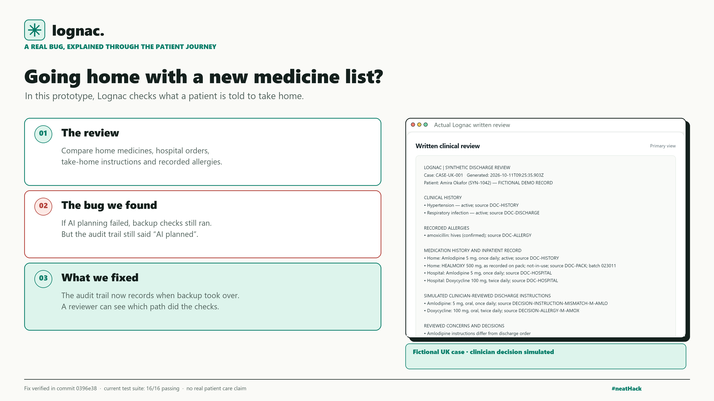

# Lognac bug-fix post

> Imagine going home with a new medicine list. I'm building Lognac to check it against your records and allergies. I found a bug: if AI planning failed, backup checks still ran, but the audit trail said “AI planned.” Fixed—reviewers now see which path actually ran. #neatHack

Evidence: commit `0396e38` changed `src/agent.js` and added `test/agent.test.js`. The written-review screenshot is from a fictional UK case. The bug affected the run's audit-mode label; it did not change the medication findings or imply that a real patient received incorrect instructions. The validated local checks still ran. Entire mapped the impacted callers in `docs/ENTIRE_GRAPH_EVIDENCE.md`. This is distinct from the separately simulated `checkAlerts` timeout shown in Neatlogs.
