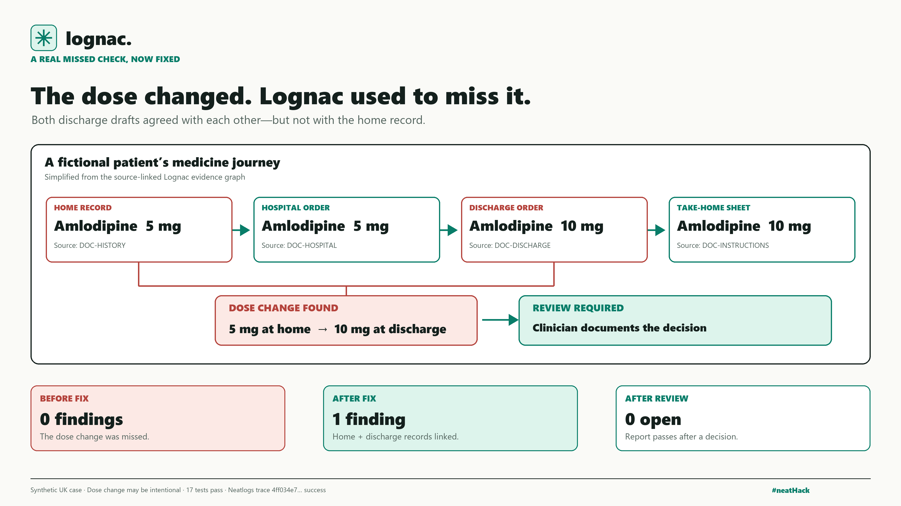

# Lognac bug-fix post

> Home record: 5 mg. Discharge order and take-home sheet: 10 mg. Lognac missed this fictional patient’s dose change because the two discharge documents agreed. I fixed it: Lognac now flags the change, links the records, and blocks the report for clinician review. #neatHack

Evidence: `data/third-case.json` is a fictional UK record. Before this fix, the case produced zero findings because discharge orders and patient instructions agreed despite a different home dose. After the fix, `HOME-CHANGE-M-AMLO` links the home and discharge sources, and a named simulated clinician must document whether the change is intentional before the report can close. The dose itself is not automatically changed. `test/doseChange.test.js` covers the finding, graph links, closure gate and rejection of an approval made stale by later edits. The final-code [hosted Neatlogs workflow trace](https://app.neatlogs.com/traces/4ff034e7b47e8996d8dde04666353a15?orgId=b25f84a0-5cac-4903-9546-23c190cb91dd&projectId=1fe23c4c-8166-4723-b508-1731c35ffaf7) read back as `success` with 13 spans. No real patient or clinical outcome is claimed.
