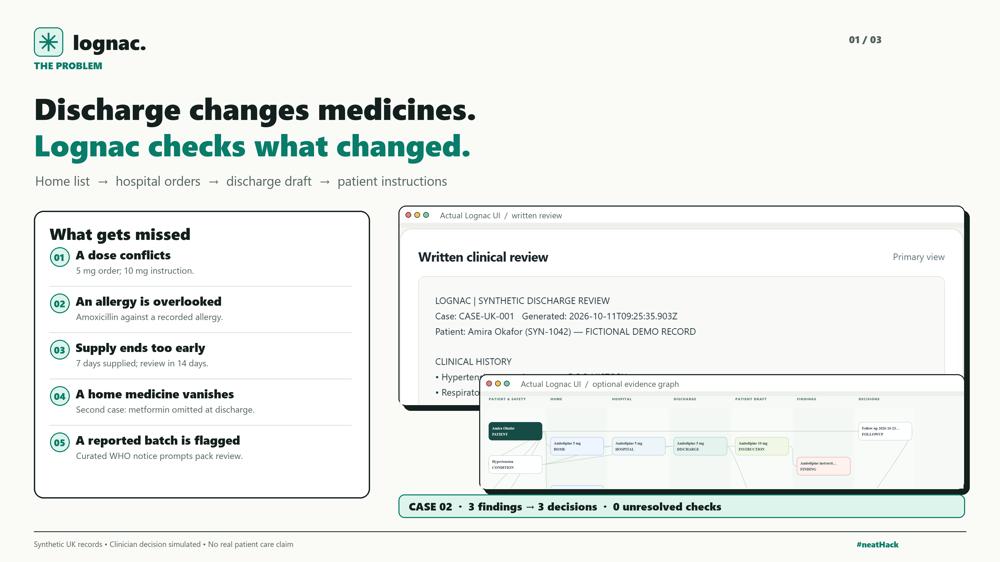
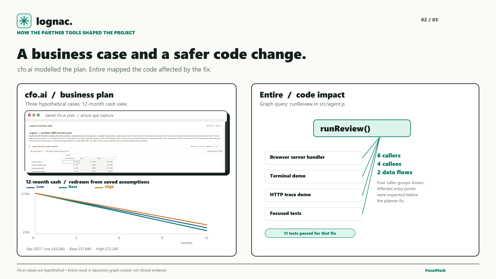
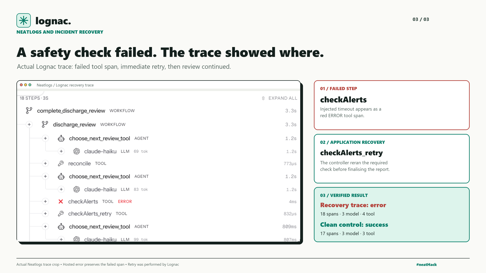

# Three Lognac build posts

These are one X post per card. They describe a synthetic prototype and verified evidence; the account owner must publish them. Each is below 280 characters before attaching its image.

## 1 — The problem

> At discharge, medicine records can drift. I’m building Lognac to compare home, hospital and discharge records; flag dose, allergy and omission gaps; require reviewer decisions; then verify a written report and optional graph. Two synthetic UK cases run end to end. #neatHack

## 2 — cfo.ai and Entire

> cfo.ai helped model Lognac’s pricing, costs and 12-month runway across three hypothetical cases. Entire mapped the code affected by a planner fix, so I could target the right tests. Those numbers are assumptions, not sales; the codebase now passes 17 tests. #neatHack

## 3 — Neatlogs recovery evidence

> Neatlogs exposed a failed safety-check span in Lognac’s simulated timeout run. The controller retried the required check, then verified the fictional report. That hosted trace stays marked error because it preserves the failure; a separate clean trace succeeded. #neatHack

The third card contains a crop of the owner's actual Neatlogs recovery trace screenshot, with added annotations and verified hosted-trace counts. It is not a screenshot of Neatlogs’ Incidents page, and it does not claim an automatic Neatlogs fix. Include an actual Incidents-page view in the revised video only after checking what the dashboard shows for Lognac.
